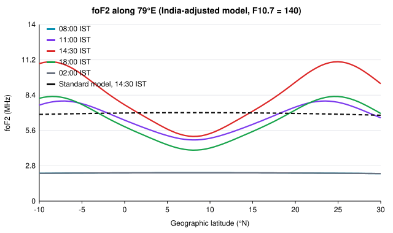
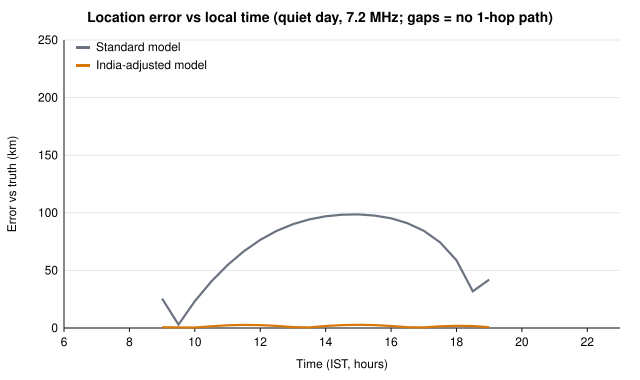
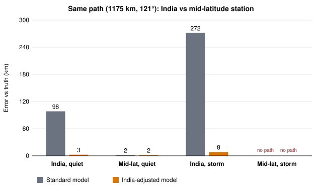
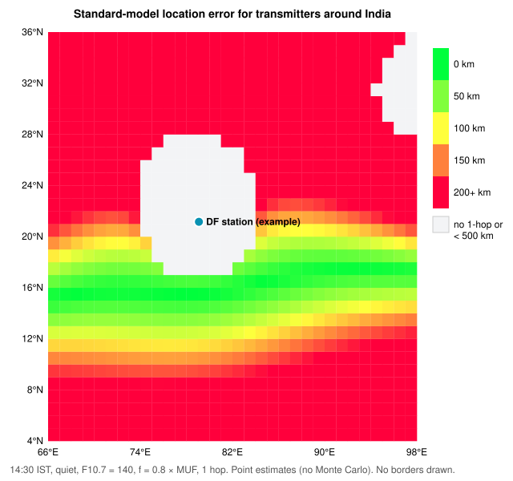

# Equatorial Ionization Anomaly Effects on HF Single-Station Location over India: A Simulation Study with an Interactive 3D Research Tool

**[Author names, affiliation]** · Draft v0.1 · 19 November 2026

> **⚠️ Update after milestone 2 (19 Nov 2026).** With IRI (PyIRI) as an independent truth, the hand-tuned India model's error on the example path is **51–199 km**, not under 10 km. The standard model's is 197–371 km. The "India-adjusted < 10 km" results below come from the circular v1 truth (Limitation 2) and must not be quoted as an achievable accuracy. See `docs/m2_results.md`. The sections below will be rewritten on IRI and ionosonde data.
>
> **Status of this draft.** All results come from the v1 prototype, which uses a *simplified, illustrative* empirical F2-layer model and mirror-model propagation (Section 3). They show the *size and mechanism* of the effect under stated assumptions. They are **not** a validated accuracy figure for any real system. Sections marked **[v2]** will be replaced with results from IRI-based ionosphere grids and numerical ray tracing.

---

## Abstract

HF single-station location (SSL) estimates where a skywave transmitter is from one direction-finding (DF) station. It does this by combining the measured azimuth and elevation of the incoming signal with a model of the ionosphere. Published SSL studies are almost all set at mid-latitudes. India, however, lies under the northern crest of the equatorial ionization anomaly (EIA). There the F2-layer critical frequency (foF2) and peak height (hmF2) depart strongly from mid-latitude behaviour, most of all in the afternoon and during geomagnetic storms. This open problem is listed by DRDO for its Industry-Academia Centres of Excellence (DIA-CoE).

We quantify how much ignoring the EIA degrades SSL over India, and whether an India-adjusted ionosphere model recovers the accuracy. We built a deterministic SSL pipeline (forward model, inverse location, Monte Carlo 95% error ellipses) and an interactive 3D web tool that is also the source of every figure. The pipeline compares a *standard* mid-latitude model with an *India-adjusted* model that includes the EIA and storm effects. Both are scored against a "truth" ionosphere that adds unmodelled small-scale structure.

For an example 1175 km path across central India at 14:30 IST, the standard model's fix is **98 km** from the transmitter on a quiet day and **272 km** during a strong storm. The India-adjusted model stays within **2.5–8.5 km**. The same geometry placed at a mid-latitude station gives **1.5 km** for both models. Over a grid of 908 transmitter positions around India, the standard model's median error is **267 km**, with only **12%** of fixes under 50 km.

The dominant mechanism is a virtual-height bias. The standard model misses the EIA uplift of hmF2, and at an 18° elevation each kilometre of virtual-height error moves the fix about 4.4 km in range. These results argue for an India-specific ionospheric input to any operational SSL algorithm. They also motivate the planned validation with IRI grids, numerical ray tracing and Indian ionosonde data.

**Keywords:** HF direction finding, single-station location, equatorial ionization anomaly, ionospheric modelling, India, skywave propagation, Monte Carlo uncertainty

---

## 1. Introduction

HF (3–30 MHz) signals travel well beyond line of sight by reflecting from the ionosphere. A DF station measures the signal's arrival azimuth (bearing) and elevation. The azimuth alone gives a line of position. A second station, or an assumption about the propagation path, is needed to fix range. **Single-station location** supplies the range from the elevation angle together with a model of the ionosphere: it estimates the height at which the signal was reflected, then computes the ground distance [3, 4, 6].

The accuracy of SSL is therefore set by two things: how well the angles are measured, and how well the ionosphere is known along the path. A US Naval Research Laboratory study named inaccuracy of the ionospheric model as a major source of systematic SSL error [4]. Recent work handles mode ambiguity with multimode ray tracing and time-frequency fusion, reaching 0.8–3.4% relative range error on measured links [3]. Most published work, however, comes from South Africa, Australia, France, the US and China. These are mid-latitude settings, or regions where the ionosphere is comparatively smooth [3–7].

India is different. Its mainland sits under the **northern crest of the equatorial ionization anomaly**. The daytime "fountain effect" lifts plasma at the magnetic equator, which then diffuses down along field lines. This forms two crests of enhanced foF2 at about ±13–20° magnetic latitude, with a trough at the equator [10–13]. Indian ionosonde chains have documented the crest near Ahmedabad and its day-to-day and solar-cycle variability [10–12]. Geomagnetic storms add large, fast changes: F-region heights over India have risen by 200–300 km during severe storms, and the EIA expands or shifts [13, 14]. Even the reference empirical model, IRI, systematically overestimates foF2 at Indian low-latitude stations, with the largest error near noon [15].

DRDO lists *"Single Station Location Algorithm for HF DF using Azimuth Bearing, Elevation Bearing and Ionospheric Model Software"* as an open research problem under Electronic Warfare (lab: DLRL). It appeared in the March 2026 DIA-CoE list and again in the September 2026 call [1, 2]. We found no open-literature study of SSL accuracy under Indian EIA conditions.

**Research question.** *How much does India's low-latitude ionosphere (the EIA) degrade single-station location accuracy, and can an India-adjusted ionosphere model correct it?*

**Contributions.**
1. A transparent, deterministic SSL pipeline (forward, inverse and Monte Carlo uncertainty) whose physics is a single, unit-tested module.
2. A controlled comparison of a standard and an India-adjusted ionosphere for the same measured angles, including a mid-latitude control, a storm sweep, a diurnal sweep and an error map over India.
3. An interactive 3D web tool that serves as the research instrument, the demonstrator and the figure generator. It runs offline in any browser.
4. A mechanism-level explanation (virtual-height bias times range sensitivity) that predicts where and when SSL over India fails.

## 2. Background

### 2.1 Single-station location

For one-hop propagation with the mirror (virtual-height) model on a spherical Earth, a ray leaving the ground at elevation β and reflecting at virtual height h′ covers a half-hop angle

  θ = π/2 − β − asin( R_E cos β / (R_E + h′) ),  so the ground range is D = 2 R_E θ.

Given β, the estimated range depends entirely on h′, which in turn depends on the electron-density profile at the reflection (control) point. Errors in h′ map into range errors through ∂D/∂h′. That derivative is large for low-elevation rays: about **4.4 km of range per km of h′** at β = 18°.

### 2.2 The equatorial ionization anomaly over India

The EIA builds after about 09:00 local time, peaks in the afternoon and early evening, and decays at night. Its crest latitude and strength depend on solar activity and season [12], on the equatorial electrojet [11], and on storms [13, 14]. Over India the northern crest lies over the mainland, at about 20–28°N geographic. A model that ignores the EIA underestimates both foF2 and hmF2 under the crest, and overestimates foF2 in the trough.

### 2.3 Related tools

PHaRLAP (Australian DST Group) is the standard HF numerical ray-tracing toolbox [8]. PyLap is its open-source Python interface [9]. PyIRI provides fast whole-globe IRI evaluation in Python [16]. NICT's HF-START is a public web tool that visualises HF ray paths using GNSS-derived electron density, mainly over Japan [17]. All of these are *forward* tools that show where a signal goes. None of them provides a public *inverse* SSL tool for the Indian region.

## 3. Method

All physics is in one pure-function module, `physics.js`, which is shared by the website, the unit tests and the figure script. That guarantees the figures and the tool agree.

### 3.1 Ionosphere models (v1, illustrative)

`getIono(lat, lon, {utHours, f107, storm, eia, tid})` returns foF2, hmF2 and the semi-thickness y_m:
- **Magnetic latitude** from a geomagnetic dipole (pole 80.8°N, 72.7°W).
- **Day/night shape** by local time, and solar-flux scaling of noon foF2: foF2_noon = 5.2 + 0.026·(F10.7 − 70) MHz.
- **EIA:** crests at ±(13 + 4e + 5s)° magnetic latitude, amplitude 0.62·e·(1 + 0.7s), a trough reduction of 0.28·e at the magnetic equator, and up to +75 km hmF2 uplift near the equator. Here e(LT) is the fountain strength (zero before 08 LT, peaking in the afternoon) and s is the storm level.
- **Storm (s ∈ [0, 1]):** a negative phase at mid and high latitudes (up to −38% foF2), +45 km hmF2 everywhere, and crest amplification with a poleward shift.
- **TIDs:** a deterministic wave pattern that perturbs foF2 by ±(4 + 12s)% and hmF2 by ±(8 + 30s) km.

Three presets are compared:

| Model | EIA | Storm-aware | TIDs | Role |
|---|---|---|---|---|
| Truth | yes | yes | yes | generates the "measured" angles |
| India-adjusted | yes | yes | no | proposed correction |
| Standard | no | no | no | mid-latitude baseline |

### 3.2 Propagation

Virtual height uses a parabolic layer with the secant law: h′ = h_b + (y_m/2)·x·ln((1 + x)/(1 − x)), where x = f·cos i / foF2, h_b = hmF2 − y_m and sin i = R_E cos β / (R_E + h_b). If x ≥ 1 the ray penetrates. Multi-hop paths (1–3 hops) sample the ionosphere at each hop midpoint.

### 3.3 Forward and inverse problems

- **Forward:** for a transmitter and station, find the low-ray elevation whose hop range equals the path length (by scanning and bisection), falling back to 2 or 3 hops if no 1-hop solution exists. The MUF is found by bisection on frequency.
- **Inverse (`locate`):** from the station, azimuth, elevation and frequency, iterate the range (with relaxation) while sampling the model ionosphere at the hop midpoint(s) along the azimuth, until the range converges (to 0.05 km).

### 3.4 Uncertainty

Monte Carlo with 240 draws and a fixed seed: σ_az = σ_el = 1°, foF2 ±7% and hmF2 ±15 km (1σ). The 95% error ellipse comes from the sample covariance in local east-north kilometres, scaled by √5.991.

### 3.5 Experiment

For each scenario, the truth model's forward solution gives the "measured" (az, β). Each model then inverts them, and the error is the great-circle distance from the true transmitter. The reference example is: station 21.15°N 79.09°E, transmitter 15.5°N 88.5°E (both examples, not real sites), 7.2 MHz, 09:00 UT (14:30 IST), F10.7 = 140. The mid-latitude control uses the same distance and bearing from a station at 50°N 10°E. All sanity values are fixed in 19 unit tests (Vitest).

## 4. The interactive research tool

The website (Vite, Three.js r160, a Web Worker for physics) has four views. **Forward** places a transmitter and station and shows the path, angles, h′ and MUF. **Inverse** traces measured angles back to estimates and ellipses for both models. **Quiet vs storm** has a storm slider and an error-versus-storm chart. **India vs Europe** runs the same path in both places, with the camera flying between them.

A 3D globe shows the F2 shell, with radius R_E + k·hmF2 (exaggeration k, default ×8) and colour and opacity mapped from foF2, so the EIA crests are visible. It also shows generic transmitter and DF-station models, mirror-model ray paths, and the Monte Carlo cloud and ellipses. The tool runs fully offline as static files. No political borders are drawn.

## 5. Results

Figures are in `docs/paper/figures/`, and all numbers are in `docs/paper/results.json`. Both are regenerated with `node docs/paper/make_figures.mjs`.

### 5.1 The modelled EIA (Fig. 1)

At 14:30 IST along 79°E, the India-adjusted model's northern crest is at **25°N with foF2 = 11.0 MHz**, against a trough of **5.1 MHz at 8°N**. The standard model is nearly flat. The crest forms after about 09:00 IST and is absent at 02:00 IST, consistent in shape with Indian ionosonde climatology [10–12]. Its exact latitude and strength are not yet calibrated **[v2]**.

### 5.2 Reference path (quiet day)

Truth gives az = 120.8°, β = 18.2°, h′ = 228 km, MUF = 14.4 MHz, one hop and a 1175 km range.

| | Standard | India-adjusted |
|---|---|---|
| Error vs truth | **98 km** (Fair) | **2.5 km** (Good) |
| 95% ellipse | 215 × 48 km | 234 × 53 km |

The ellipses are similar in size, so the standard model's error is a **bias**, not extra scatter. Both ellipses are elongated along the range direction (major axis at about −35° from east, close to the path bearing), because elevation error maps mainly into range. On this quiet afternoon the 98 km bias still lies inside the standard model's 95% ellipse (normalised distance q = 0.21). The ellipse hides the bias but does not yet contradict it.

### 5.3 Storm sensitivity (Fig. 2)

As the storm level rises from 0 to 1, the standard model's error grows almost linearly: **98 → 191 → 272 km** (at storm 0, 0.5 and 1). The India-adjusted model stays at **2.5–8.5 km**. Its residual comes only from the TIDs, which are larger in storms. At storm level 1 the standard model's ellipse shrinks to 172 × 40 km, because higher rays (β = 22.8°) are less range-sensitive. The true transmitter then lies **outside** that 95% ellipse (q = 2.49). The standard model is *confidently wrong*: its stated uncertainty no longer covers its error.

### 5.4 Time of day (Fig. 3)

At 7.2 MHz a 1-hop path exists only from about 09:00 to 19:00 IST. Outside that window foF2 is too low and the signal penetrates. The standard model's error follows the fountain: near zero in the morning, peaking at about **99 km around 14:30–15:00 IST**, and falling in the evening. The India model stays under about 3 km.

### 5.5 India versus mid-latitude (Fig. 4)

With the same 1175 km, 121° path from 50°N 10°E, both models err by **1.5 km** on a quiet day. During a strong storm, the mid-latitude negative phase drops the MUF to **5.5 MHz**, so 7.2 MHz has no skywave path at all. The India-specific penalty for ignoring the EIA is therefore about **+97 km** quiet and about **+263 km** in storms on this path.

### 5.6 Error map over India (Fig. 5)

For a fixed station (example, 21.15°N 79.09°E), transmitters on a 1° grid from 4–36°N and 66–98°E (more than 500 km from the station) were run at f = 0.8 × MUF, one hop, 14:30 IST, quiet conditions. Across **908 cells**:

| | Standard | India-adjusted |
|---|---|---|
| Median error | **267 km** | **5.5 km** |
| 90th percentile | 532 km | n/a |
| Fixes under 50 km ("Good") | **12%** | **100%** |

The errors form latitude bands. A narrow low-error strip at about 14–18°N is where the standard model's virtual-height bias happens to change sign. Large errors appear toward the crest (north) and trough (south).

## 6. Discussion

**Mechanism.** At the reference control point (18.4°N, 83.9°E; magnetic latitude 9.9°), the truth ionosphere at 14:30 IST has foF2 = 8.38 MHz and hmF2 = 326 km. The standard model has 6.94 MHz and 285 km. For the measured β = 18.2°, this puts the standard model's h′ at **206 km instead of 228 km**. With ∂D/∂h′ ≈ 4.4 km/km, that predicts a range shortfall of about 100 km, matching the observed 98 km. During the storm, truth hmF2 rises to 369 km (h′ = 285 km) while the standard model stays at 285 km (h′ = 212 km). The predicted 73 km h′ bias gives a fix 272 km short.

**Implication for algorithm design.** A better angle sensor alone cannot fix an SSL bias of this kind: halving σ_el shrinks the ellipse but leaves the bias unchanged. The ionospheric input has to represent (i) the EIA crest and trough, (ii) the afternoon uplift of hmF2, and (iii) storm-time uplift and crest shift. That means a regional model updated with real-time data (Indian ionosondes, GNSS/NavIC TEC) rather than a climatological mid-latitude profile.

**Quality factor.** Because the standard model can be confidently wrong (its storm-time ellipse excludes the truth), an SSL system should report a quality measure that tests consistency between the measured elevation and the model-predicted modes. One example is the quality factor proposed for South African SSL [6]. The tool's fix-quality pill (Good < 50 km, Fair 50–150 km, Poor > 150 km) is a first step.

## 7. Limitations

1. **Illustrative ionosphere.** The v1 F2 model is empirical and hand-tuned, not IRI. Crest latitude and amplitude, storm response and TIDs are representative, not calibrated to Indian data.
2. **Circularity.** "Truth" is the India-adjusted model plus TIDs. The India model's small error is therefore an *upper bound on its benefit*, not a validation. A fair test needs an independent truth: IRI driven by real indices, or ionosonde and GNSS measurements **[v2/v3]**.
3. **Propagation physics.** Mirror model only: no numerical ray tracing, no horizontal gradients or tilts (which bias the measured azimuth [4, 7]), no magneto-ionic (O/X) splitting, no E or F1 layers, and the low ray only.
4. **Mode identification.** The hop count is assumed to be known. In practice mode ambiguity is a major error source [3].
5. **Geomagnetic field.** A dipole is used, not IGRF.
6. **Statistics.** A single Monte Carlo seed and one reference path. No seasonal variation, because the v1 model ignores the date.

## 8. Future work

- **[v2] Real ionosphere:** precompute PyIRI or iri2016 grids for India by month, hour and F10.7, loaded by the tool as JSON [16].
- **[v3] Numerical ray tracing** with PHaRLAP/PyLap through those grids, including tilts [8, 9]. Validate against published SSL accuracy figures [3, 6], and against Indian ionosondes (Trivandrum TM308 via GIRO, Ahmedabad, Tirunelveli) and GNSS/NavIC TEC [18].
- **[v4] Research outputs:** error maps by season, hour and solar activity. A correction model (for example, ionosonde-assimilated hmF2) and its residual error. Multi-mode SSL in the style of [3], adapted to EIA conditions.

## 9. Conclusion

Within the stated simplifications, ignoring the equatorial ionization anomaly biases HF single-station location over India by about 100 km on a quiet afternoon and by more than 250 km in a storm, on a path where a mid-latitude station errs by only 1–2 km. Across India the median bias is about 270 km. The error is driven by an hmF2 and virtual-height bias, amplified by the range sensitivity of low-elevation rays. Including the EIA and storm effects removes almost all of it in simulation. This makes an India-specific ionospheric input a requirement for the DRDO SSL problem, and it defines a concrete validation programme using IRI, ray tracing and Indian ionosonde and GNSS data.

## Data and code availability

Physics module, unit tests, web tool and figure script: `web/src/physics.js`, `web/src/physics.test.js`, `web/`, and `docs/paper/make_figures.mjs` in this repository. All coordinates are examples. No real system specifications are used.

## References

1. DRDO, *Research Problems for DIA-CoEs*, March 2026. https://iitk.ac.in/dord/diacoe/data/Research_Problems_for_DIA-CoEs-Mar-2026.pdf
2. DRDO, *Research Problems for DIA-CoEs*, September 2026 (call closes 31 Dec 2026). https://iitk.ac.in/dord/diacoe/data/Research-Problems-for-DIA-CoEs-Sep-2026.pdf
3. Q. Li, W. Liu, Y. Ning, Z. Deng, J. He, M. Liu, C. Xia, "HF single-station localization via multimode ray tracing and time-frequency information fusion," arXiv:2610.13560, 2026. https://arxiv.org/abs/2610.13560
4. Naval Research Laboratory, HF single-station location report (DTIC ADA133208). https://apps.dtic.mil/sti/pdfs/ADA133208.pdf
5. Additional DTIC SSL report (ADA264667). https://apps.dtic.mil/sti/pdfs/ADA264667.pdf
6. "Definition of a quality factor for single site location estimates," University of Pretoria repository, 2016. https://repository.up.ac.za/handle/2263/56632
7. P. J. Coetzee, "Determining the electromagnetic constants of ground and analyzing HF propagation with the aid of a modern interferometric direction finder," PhD thesis, University of Pretoria, 2018. https://repository.up.ac.za/handle/2263/70554
8. M. A. Cervera, PHaRLAP: Provision of High-frequency Raytracing LAboratory for Propagation studies, DST Group. https://www.dst.defence.gov.au/opportunity/pharlap-provision-high-frequency-raytracing-laboratory-propagation-studies
9. D. Diehl et al., "PyLap: An open source Python interface to the PHaRLAP ionospheric raytracing toolkit," HamSCI, 2023. https://hamsci.org/publications/pylap-open-source-python-interface-pharlap-ionospheric-raytracing-toolkit
10. P. B. Jayachandran et al., "Role of the equatorial ionization anomaly in the initiation of equatorial spread F," *Ann. Geophys.* 15, 255, 1997. https://angeo.copernicus.org/articles/15/255/1997/
11. H. Chandra, S. Sharma, Aung, "Day-to-day variability of foF2 at Ahmedabad," *J. Ind. Geophys. Union* 13(4), 2009. https://iguonline.in/journal/Archives/13-4/24harish.pdf
12. S. Yadav et al., multistation study of the EIA over India using seven ionosondes, 2013 (as summarised in [11]; full text to be verified).
13. R. S. Dabas et al., "Response of equatorial and low-latitude ionosphere to severe geomagnetic storms," *Ann. Geophys.* 24, 97, 2006. https://angeo.copernicus.org/articles/24/97/2006/
14. Indian Institute of Geomagnetism, storm-time electric field studies along the Indian longitude (e.g. June 2015 storm). https://repository.iigm.res.in/
15. P. Pavan Chaitanya, A. K. Patra, N. Balan, S. V. B. Rao, "Ionospheric variations over Indian low latitudes close to the equator and comparison with IRI-2012," *Ann. Geophys.* 33, 997–1006, 2015. https://angeo.copernicus.org/articles/33/997/2015/
16. V. V. Forsythe et al., "PyIRI: Whole-globe approach to the International Reference Ionosphere modeling implemented in Python," *Space Weather*, 2024. https://pyiri.readthedocs.io/
17. NICT, HF-START: High Frequency Simulator Targeting for All-users' Regional Telecommunications. https://hfstart.nict.go.jp/readme_e.html
18. Global Ionosphere Radio Observatory (GIRO), Trivandrum TM308 Digisonde. https://giro.uml.edu/

*Reference details marked "to be verified", and author lists not shown in full, must be checked against the original papers before submission.*
